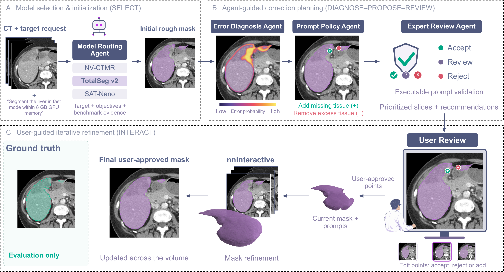

<div align="center">

# MISeg-Agent

### A Human-in-the-Loop Agentic Framework for Error Diagnosis and Executable Prompt Review in 3D Medical Image Segmentation

**Find suspected errors · Probe corrective points · Keep the user in control**

[Overview](#-overview) · [Framework](#-framework) · [Installation](#%EF%B8%8F-installation) · [Model weights](#-model-weights) · [Quick start](#-quick-start)

</div>

---

## 📌 Overview

**MISeg-Agent** is a human-in-the-loop framework for 3D medical image segmentation. This repository contains a focused Python implementation of its central ideas: benchmark-informed model routing, model-agnostic voxel-wise error diagnosis, diagnosis-conditioned point proposal, executable prompt review, and human-controlled mask commitment.

An initial segmentation is treated as a starting point. The current CT and mask are used to identify likely **false negatives** (missing foreground) and **false positives** (excess foreground). Proposed corrections are tested with nnInteractive before the user selects points, inspects their joint effect, and commits a new mask.

## 🧠 Framework



**Figure 1. Overview of MISeg-Agent.** Model routing provides an initial mask; error diagnosis, point proposal, and executable review guide user inspection; nnInteractive refines the mask using user-approved points. Ground truth is shown for evaluation only.

### Core components

| Component | What it does | Code |
| :--- | :--- | :--- |
| Model routing | Filters automatic 3D tools by target compatibility, then uses quality, reliability, time, and memory evidence | [`routing/`](src/miseg_agent/routing/) |
| Error diagnosis | Four-channel residual 3D U-Net with factorized error and FN-polarity scores | [`diagnosis/`](src/miseg_agent/diagnosis/) |
| Point proposal | One interior point per eligible 18-connected FN/FP component, with physical-distance history suppression | [`prompts/`](src/miseg_agent/prompts/) |
| Executable review | Compares each mask-plus-point result with a shared mask-only control and the current mask | [`review/`](src/miseg_agent/review/) |
| Human-controlled loop | Tracks mask versions; separates probe, preview, rejection, and explicit commitment | [`session.py`](src/miseg_agent/session.py) |

The diagnosis, proposal, and review path uses **no ground truth at inference** and runs locally with the required model checkpoints. The optional conversational interface from the development application is outside this release.

## 📁 Repository structure

```text
MISEG-AGENT/
├── README.md
├── pyproject.toml
├── requirements.txt
├── .gitignore
├── assets/
│   └── pipeline.png
├── configs/
│   └── core.yaml
├── examples/
│   ├── interactive_session.py
│   └── points.example.json
└── src/miseg_agent/
    ├── routing/           # Capability filtering and benchmark policy
    ├── diagnosis/         # Architecture, preprocessing, losses, inference
    ├── prompts/           # Component representatives and history
    ├── review/            # Model-response evidence and decision rules
    ├── backends/          # nnInteractive adapter and interaction parsing
    ├── session.py         # Versioned human-controlled correction loop
    ├── io.py              # Shared physical grid and NIfTI export
    └── cli.py             # Single-case command-line entry points
```

## ⚙️ Installation

Use Python 3.10 or newer. Install a PyTorch build appropriate for your device before installing the optional nnInteractive backend; see the [official PyTorch installer](https://pytorch.org/get-started/locally/).

From the root of this repository:

```bash
python -m venv .venv
```

Activate the environment:

```bash
# Linux / macOS
source .venv/bin/activate
```

```powershell
# Windows PowerShell
.\.venv\Scripts\Activate.ps1
```

Install the core package, then the interactive backend if needed:

```bash
python -m pip install -e .
python -m pip install -e ".[interactive]"
python -m miseg_agent --help
```

`python -m pip install -r requirements.txt` is an alternative to the core installation command. The nnInteractive extra pins the adapter's source-environment package version to `2.5.1`; it does not install checkpoints. Full-volume inference should use an appropriately provisioned GPU. The small routing/proposal computations can run on CPU.

## 📦 Model weights

**No foundation-model or MISeg-Agent checkpoint files are included in this repository.** Download models separately from their official publishers. Store them under local `checkpoints/` or `foundation_models/` folders, which are excluded by `.gitignore`.

| Model | Role | Official weights / download instructions |
| :--- | :--- | :--- |
| nnInteractive | Independent probes and joint refinement | [MIC-DKFZ/nnInteractive](https://huggingface.co/MIC-DKFZ/nnInteractive) · [official setup](https://github.com/MIC-DKFZ/nnInteractive) |
| TotalSegmentator v2 | Automatic initial mask | [Official automatic download / `totalseg_download_weights`](https://github.com/wasserth/TotalSegmentator#other-commands) |
| NV-Segment-CT / VISTA3D | Automatic initial mask | [nvidia/NV-Segment-CT](https://huggingface.co/nvidia/NV-Segment-CT) |
| NV-Segment-CTMR | Automatic initial mask | [nvidia/NV-Segment-CTMR](https://huggingface.co/nvidia/NV-Segment-CTMR) |
| SAT-Nano | Text-conditioned initial mask | [zzh99/SAT](https://huggingface.co/zzh99/SAT) — segmentation and text-encoder checkpoints |
| SegVol | Text-conditioned initial mask | [BAAI/SegVol](https://huggingface.co/BAAI/SegVol) |
| MISeg-Agent error diagnosis | FN/FP diagnosis | No verified public checkpoint URL is currently available |

The five automatic segmentation systems are routing targets, with upstream installation and inference kept separate. Supply their binary output to MISeg-Agent. Preserve each publisher's model configuration and label mappings alongside the weights. SAT-Nano requires both the Nano segmentation model and its paired text encoder; SegVol requires its tokenizer/configuration files. TotalSegmentator automatically downloads its weights on first use, or through `totalseg_download_weights -t total`.

After installing the interactive extra, download nnInteractive with its model-management API:

```python
from pathlib import Path
from nnInteractive.model_management import ensure_model_available

model_path = ensure_model_available(
    "nnInteractive_v1.0", model_root=Path("checkpoints").resolve()
)
print(model_path)
```

Pass the printed directory to `--nninteractive-model`. Keep the complete directory, including `plans.json`, `dataset.json`, and `fold_0/checkpoint_final.pth`. The [official nnInteractive instructions](https://github.com/MIC-DKFZ/nnInteractive#getting-started) describe installation and checkpoint terms.

## 🚀 Quick start

### 1. Route an initial segmentation request

List only models that are actually installed and usable on your system:

```bash
python -m miseg_agent route --target liver --case-id case001 --available totalsegmentator nv_segment_ct segvol
```

The command returns a selected tool and its reasoning; it does **not** execute that model. `--objective` accepts `accuracy`, `balanced`, `latency`, `gpu_memory`, `unrestricted_latency`, or `unrestricted_gpu_memory`. Use `--model` for an explicit compatible choice and `--dataset` for a dataset-specific evidence lookup.

The bundled routing evidence is an explicitly labeled **historical 90-case snapshot**, not the manuscript's final 120-case benchmark. Replace it with validated deployment evidence when needed; do not interpret its resource numbers as measurements on your hardware.

### 2. Prepare a CT and an initial binary mask

```text
data/case001/
├── image.nii.gz
└── rough_mask.nii.gz

checkpoints/
├── error_diagnosis_v2.pt
└── models/
    └── nnInteractive_v1.0/
        ├── dataset.json
        ├── plans.json
        └── fold_0/
            └── checkpoint_final.pth
```

These folders are local inputs and are excluded by `.gitignore`. The CT should contain unnormalized HU values. Use a single binary target mask or specify `--mask-label` for a multiclass mask. MISeg-Agent resamples CT and mask onto one physical workspace, `256 × 256 × 256` by default, with linear and nearest-neighbor interpolation respectively.

### 3. Diagnose and propose points

After obtaining a compatible **factorized ED V2** checkpoint:

```bash
python -m miseg_agent analyze --image data/case001/image.nii.gz --mask data/case001/rough_mask.nii.gz --checkpoint checkpoints/error_diagnosis_v2.pt --config configs/core.yaml --output outputs/case001
```

To additionally run independent executable review, add:

```text
--nninteractive-model checkpoints/models/nnInteractive_v1.0
```

Outputs include the workspace CT, current mask, three diagnosis score volumes, and `review.json` with candidate points and review evidence. The loader requires the checkpoint contract in [`diagnosis/contracts.py`](src/miseg_agent/diagnosis/contracts.py); older two-channel diagnosis weights are incompatible.

### 4. Inspect a joint refinement

Create a JSON list of the points you selected after inspecting the CT and evidence:

```json
[
  {"point_xyz": [120, 128, 64], "label": 1},
  {"point_xyz": [96, 112, 70], "label": 0}
]
```

Coordinates are **zero-based `[x, y, z]` indices in the workspace**, not native-image indices. `1` adds foreground; `0` removes foreground. The values above illustrate the format and must be replaced with case-specific points.

Run `analyze` again with an empty output directory, `--nninteractive-model`, and `--points path/to/selected_points.json`. It re-probes the selected coordinates and writes `preview_workspace.nii.gz` and `preview_native.nii.gz`. **A preview is never committed automatically.** Inspect it in your image viewer before accepting it.

For an application that keeps a session in memory, [`examples/interactive_session.py`](examples/interactive_session.py) demonstrates diagnosis, review, user selection, preview, explicit confirmation, and export. A committed mask invalidates previous evidence; fresh diagnosis is required before further guidance.

## 🔬 Error-diagnosis learning components

The release includes the four-channel input builder, residual 3D U-Net, error/polarity/foreground targets, training losses, checkpoint contract, and calibrated inference. It excludes dataset-specific training jobs and experiment orchestration.

The four channels are soft-tissue CT, wide-window CT, the current binary mask, and its clipped signed-distance field. The predicted scores are:

$$
e=\sigma(z_e/T_e),\qquad b=\sigma(z_b/T_b),\qquad
(p_{\mathrm{correct}},p_{\mathrm{FN}},p_{\mathrm{FP}})=(1-e,eb,e(1-b)).
$$

These are model estimates. Proposal and review reuse them; a passing review is not an independent guarantee of anatomical correctness. Implementation defaults use CT windows of `[-200, 300]` and `[-1000, 1000]` HU, a distance clip of 20 mm, 24 base channels, four levels, and dropout 0.1. Checkpoint metadata determines the actual inference configuration; these defaults have not been independently verified as the settings used for the reported experiments.

The checkpoint loader requires `format=miseg_agent_error_diagnosis`, `model_version=2`, `architecture=factorized_resunet3d`, and `input_contract=ct_and_rough_mask_only`, together with model/preprocessing configuration, calibration values, deployment thresholds, and training metadata. A compatible trained checkpoint is not currently included or publicly linked.

## 📚 Paper

**MISeg-Agent: A Human-in-the-Loop Agentic Framework for Error Diagnosis and Executable Prompt Review in 3D Medical Image Segmentation**

The repository uses the title of the accompanying manuscript. Publication metadata and a verified public paper link are not included in this release.

## 🙏 Acknowledgements

This implementation uses [PyTorch](https://pytorch.org/), [NumPy](https://numpy.org/), [SciPy](https://scipy.org/), and [SimpleITK](https://simpleitk.org/). Executable review uses [nnInteractive](https://github.com/MIC-DKFZ/nnInteractive). Initial-mask routing references the upstream models listed above. Please acknowledge and follow the terms of each upstream project you use.

## License

No license has been specified for the original MISeg-Agent code in this release. Third-party software and model weights retain their own licenses; links to them do not grant additional rights.
